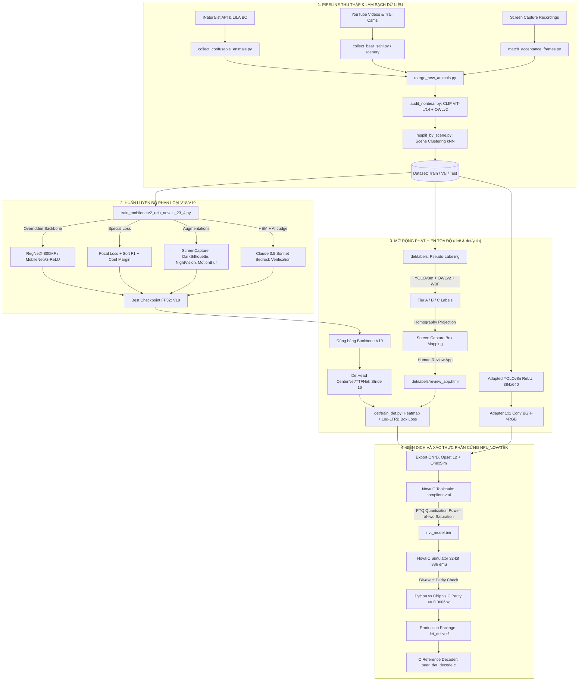
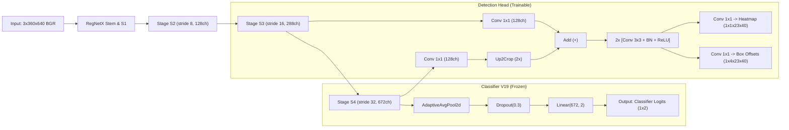

# TÀI LIỆU PHÂN TÍCH TOÀN DIỆN VÀ ĐẶC TẢ KỸ THUẬT HỆ THỐNG BEAR DETECTION (NT98560 EDGE AI)

---

## 1. TỔNG QUAN HỆ THỐNG VÀ BỐI CẢNH DỰ ÁN

### 1.1. Mục tiêu và sứ mệnh
Dự án **Bear Detection** là hệ thống AI thị giác máy tính phát hiện gấu thời gian thực (Real-time Bear Detection) được thiết kế chuyên biệt để triển khai trên các thiết bị camera giám sát dã ngoại / bẫy ảnh (trail cameras) và camera an ninh biên giới chạy chip xử lý biên **Novatek NT98560 SoC (NPU NovaIC)**.

Hệ thống được phát triển qua nhiều giai đoạn tiến hóa (từ V1 đến V19 và mở rộng nhánh phát hiện tọa độ `det/`):
- **Phân loại nhị phân (Binary Classification):** Xác định sự xuất hiện của gấu (`bear` vs `non_bear`) với độ nhạy (Recall) cực cao, triệt tiêu báo động giả (False Positive - FP) do động vật tương đồng hoặc biến đổi môi trường.
- **Phát hiện vùng đối tượng (Bounding Box Detection):** Tích hợp thêm Box Detection Head nhẹ trên cùng backbone RegNetX-800MF đã đóng băng (đảm bảo giữ nguyên logic bộ phân loại) hoặc biến thể YOLOv8n ReLU tối ưu riêng cho NPU Novatek.
- **Tối ưu hóa phần cứng NPU Biên:** Tuân thủ các giới hạn khắt khe của vi xử lý Novatek NT98560 (định dạng lượng tử hóa số nguyên điểm cố định Power-of-two Saturation, 12-bit weights, 16-bit accumulators, loại bỏ toán tử không tương thích như `Clip` trong ReLU6, SiLU, hay Softmax/Attention phức tạp).

---

### 1.2. Những thách thức thực tế và bài toán kỹ thuật đặc thù
Dự án giải quyết 4 nhóm vấn đề thực tế vô cùng phức tạp:

1. **Phương pháp nghiệm thu qua màn hình (Camera Filming Screen Acceptance):**
   - Đối tác / Khách hàng nghiệm thu bằng cách dùng camera vật lý quay trực tiếp vào màn hình laptop/PC hiển thị video và ảnh test.
   - Hiện tượng phát sinh: Nhiễu vân sóng Moiré, sọc quét (scanlines), viền màn hình (bezel), lóa sáng phản chiếu phòng (glare/reflection), góc nghiêng phối cảnh (perspective distortion), mất bão hòa màu do camera hồng ngoại (IR desaturation).
   - *Giải pháp:* Thiết kế riêng bộ biến đổi dữ liệu `ScreenCaptureAugmentation` và hệ thống khớp phối cảnh Homography (`match_acceptance_frames.py`, `homography.py`).

2. **Dương tính giả (False Positives - FP):**
   - Người mặc đồ đen, bóng người trong bóng râm / ngược sáng.
   - Động vật có lông đen, dáng vóc to hoặc tương đồng trong bẫy ảnh: Nai sừng tấm (Elk, Moose), lợn rừng (Wild boar), gấu mèo (Raccoon), chó mực (Dark dogs), chó sói (Coyote), chồn, khỉ, cáo.
   - Rung lắc camera do gió hoặc lắp đặt, thay đổi ánh sáng đột ngột (bật/tắt đèn, mây che).
   - *Giải pháp:* Tăng cường dữ liệu có chủ đích (`LightingChangeAugmentation`, `DarkSilhouetteAugmentation`, `StrongMotionBlur`, `CameraShakeAugmentation`), khai thác dữ liệu bẫy ảnh toàn cầu (iNaturalist, LILA BC), và kiểm toán nhãn bằng OpenAI CLIP / OWLv2.

3. **Âm tính giả (False Negatives - FN):**
   - Gấu ở khoảng cách xa (kích thước pixel nhỏ).
   - Gấu bị che khuất một phần lớn (bụi cây, cành cây, vách đá, bóng tối).
   - Bẫy ảnh ban đêm dùng đèn hồng ngoại (IR Night Vision) làm mất chi tiết màu lông.
   - *Giải pháp:* Bộ tăng cường `NightVisionSimulation`, `DistanceSimulation`, `HeavyOcclusionSimulation`, cùng kỹ thuật huấn luyện mất mát Focal Loss + Soft F1.

4. **Tránh rò rỉ dữ liệu (Data Leakage) giữa các tập Train/Val/Test:**
   - Việc phân chia ngẫu nhiên hoặc theo băm tri giác (phash) trước đây khiến các khung hình trong cùng một đoạn video xuất hiện ở cả Train và Val (43% ảnh gấu ở Val có ảnh sinh đôi trong Train với độ tương đồng CLIP cosine $\ge 0.95$). Điều này dẫn đến việc điểm F1 cao nhưng thực chất là mô hình "học vẹt".
   - *Giải pháp:* Viết thuật toán gom cụm phân cảnh (`resplit_by_scene.py`) dựa trên đồ thị kNN nhúng CLIP ViT-L/14, đảm bảo toàn bộ khung hình của cùng một phân cảnh chỉ thuộc về một tập duy nhất (Train 70%, Val 15%, Test 15%).

---

## 2. KIẾN TRÚC TỔNG THỂ HỆ THỐNG



---

## 3. CHI TIẾT TỪNG MODULE TRONG MÃ NGUỒN

### 3.1. Thư mục gốc: Thu thập, Kiểm toán và Huấn luyện Backbone

#### `train_mobilenetv2_relu_novaic_23_4.py` (106 KB, 2385 dòng)
Đây là script huấn luyện cốt lõi nhất của toàn bộ hệ thống phân loại. Các điểm kỹ thuật nổi bật:
- **Tiền xử lý khớp 100% phần cứng NovaIC:**
  $$\text{Input Tensor} = \frac{\text{BGR} - [104, 116, 124]}{255}$$
  Không chia cho độ lệch chuẩn $\sigma$, giữ nguyên thang đo [0, 1].
- **Loại bỏ Clip operator:** Thay thế toàn bộ `ReLU6` trong MobileNetV2 bằng `ReLU` thuần túy. Lý do: Toán tử `Clip` trên NPU NT98560 gây tràn bit hoặc mất mát nghiêm trọng khi lượng tử hóa PTQ.
- **Hỗ trợ Backbone RegNetX (`OVERRIDE_BACKBONE=regnetx_008`):** Bọc mô hình từ thư viện `timm`, thay thế tầng phân loại bằng `Dropout(0.3) -> Linear(num_features, 2)`.
- **Hàm mất mát kết hợp đa thành phần (`CombinedLoss`):**
  $$\mathcal{L} = \mathcal{L}_{\text{Focal}} + 0.3 \cdot \mathcal{L}_{\text{SoftF1}} + 0.1 \cdot \mathcal{L}_{\text{Margin}}$$
  - `FocalLoss`: $\alpha = 0.5$, $\gamma = 2.5$, kèm nhãn làm mịn `label_smoothing=0.05`.
  - `SoftF1Loss`: Tối ưu hóa trực tiếp metric F1 khả vi, cân bằng độ chính xác và độ nhạy.
  - `ConfidenceMarginLoss`: Phạt các dự đoán nằm trong khoảng bất định $[0.5 - \text{margin}, 0.5 + \text{margin}]$ (với $\text{margin}=0.3$), buộc mô hình phải dứt khoát hướng về 0 hoặc 1.
- **Ngưỡng quyết định cố định 0.50:** Firmware chip Novatek sử dụng `argmax` giữa 2 logits ($p > 0.5$). Do NPU tái lượng tử hóa bias theo kênh, việc dịch ngưỡng bias trong PyTorch sẽ bị NPU triệt tiêu. Vì vậy mọi điều chỉnh cân bằng Precision/Recall bắt buộc phải giải quyết qua hàm mất mát và trọng số mẫu.
- **Hệ thống tăng cường dữ liệu chuyên sâu:**
  - `ScreenCaptureAugmentation`: Mô phỏng quay màn hình (vân Moiré bậc 1 và bậc 2, scanlines, viền đen màn hình, lóa sáng phản xạ, biến dạng góc nhìn perspective, chuyển màu hồng ngoại IR).
  - `DarkSilhouetteAugmentation`: Tạo các đốm đen ngẫu nhiên (`dark_blob`), tăng độ tương phản và ngược sáng (`backlight`) trên nền sáng để mô hình học cách phân biệt người mặc đồ đen với gấu.
  - `LightingChangeAugmentation`: Mô phỏng bật/tắt đèn đột ngột, bóng râm mây che, sai lệch cân bằng trắng (color cast), điều chỉnh độ phơi sáng tự động (auto-exposure gamma).
  - `StrongMotionBlur` & `CameraShakeAugmentation`: Rung lắc đa hướng, rung giật khung hình, nhòe chuyển động.
  - `NightVisionSimulation`: Giảm sáng cực đại, mô phỏng camera hồng ngoại thang xám, tương phản thấp, hạt nhiễu Gaussian và ánh xanh IR.
  - `DistanceSimulation`: Thu nhỏ vật thể gấu (tỉ lệ 0.2 - 0.55), dán vào nền được cắt mờ từ góc ảnh gốc (`_corner_background`) để không tạo bóng ma silhouette giả mạo.
- **Khai thác mẫu khó (Hard Example Mining - HEM) có AI thẩm định:**
  Tích hợp AWS Bedrock (Claude 3.5 Sonnet) để thẩm định tự động các mẫu phân loại sai: phân biệt giữa ảnh nhãn sai thật sự và ảnh mẫu khó, lưu cache tại `hem_gemini_cache.pkl`.
- **Huấn luyện tương phản có giám sát (SupCon):** Tích hợp `ProjectionHead` và `supcon_loss` trong quá trình huấn luyện nhằm kéo gần khoảng cách vector đặc trưng của các trường hợp gấu đêm khó nhằn và đẩy xa các động vật lông tối màu.

---

#### `novaic_eval.py` (28 KB, 607 dòng)
Cầu nối trực tiếp giữa PyTorch checkpoint và toolchain của hãng Novatek:
- **Chu trình đánh giá chuẩn phần cứng:**
  $$\text{Checkpoint (.pth)} \longrightarrow \text{ONNX} \longrightarrow \text{compiler.nvtai} \longrightarrow \text{simulator.nvtai} \longrightarrow \text{Báo cáo}$$
- **Cơ chế mô phỏng chính xác từng bit (Bit-accurate Simulator):** Chạy giả lập engine CNN/NUE của chip NT98560 (dùng binary x86 32-bit `i386`). Đo lường độ sai lệch $\text{cosine}(\text{fixed}, \text{float})$ cho từng layer trên từng ảnh.
- **Sửa lỗi lịch sử quan trọng:** Phát hiện và sửa lỗi lệch thứ tự Mean BGR từ các bản V1-V17 (trước đây trừ [124, 116, 104] thay vì [104, 116, 124]), giúp lấy lại tới 6 điểm Recall tưởng chừng bị mất do lượng tử hóa.

---

#### `resplit_by_scene.py` (10.6 KB, 271 dòng)
Giải quyết triệt để vấn đề rò rỉ dữ liệu video:
- Trích xuất đặc trưng toàn bộ tập dữ liệu bằng OpenAI CLIP ViT-L/14.
- Xây dựng đồ thị k-Nearest Neighbors (kNN với $k=32$) tính cosine similarity.
- Áp dụng cấu trúc Union-Find để nhóm các ảnh có độ tương đồng $\ge \text{threshold}$ thành các cụm phân cảnh (Connected Components).
- Phân bổ nguyên cụm phân cảnh vào duy nhất một tập Train, Val, hoặc Test theo tỉ lệ 70% / 15% / 15%. Các phân cảnh quá lớn sẽ bị ép vào Train để tránh làm sai lệch tập Val/Test. Đồng thời giới hạn tối đa $N$ ảnh cho mỗi phân cảnh trong Train để tránh trường hợp một video quá dài lấn át dữ liệu.

---

#### `audit_nonbear.py` (32 KB, 721 dòng)
Kiểm toán tập nhãn âm tính (`non_bear`):
- Sử dụng ensemble 3 mô hình độc lập: V16 FP32, V17 FP32 và mô hình Open-Vocabulary OWLv2 (`google/owlv2-base-patch16-ensemble`) với câu lệnh truy vấn `"a bear"`.
- Phát hiện các khung hình dán nhãn nhầm là `non_bear` nhưng thực chất có gấu (ví dụ gấu trên camera chuông cửa Ring, gấu con trong vườn, gấu bới thùng rác).
- Đưa ra danh sách cho con người xem xét và cách ly (quarantine), bảo đảm không để nhãn sai đầu độc mô hình.

---

#### `collect_confusable_animals.py` & `collect_lila_confusables.py` (42 KB & 10 KB)
- Tự động tải hình ảnh các loài vật dễ gây báo động giả từ API công khai của iNaturalist (dựa trên Taxon ID chuẩn: Elk=41782, Moose=41774, Raccoon=41680, Wild Boar=42134, v.v.) và LILA BC Camera Traps.
- Lọc chất lượng bằng CLIP và xác minh tính toàn vẹn của dữ liệu.

---

#### `match_acceptance_frames.py` & `verify_screencap.py` (15.6 KB & 17.1 KB)
- Xử lý các đoạn video quay màn hình nghiệm thu thực tế của đối tác: Tìm kiếm các điểm đặc trưng ORB (Oriented FAST and Rotated BRIEF) và tính toán ma trận Homography RANSAC giữa ảnh khung hình quay được và ảnh chuẩn gốc trong bộ test.
- Chống lóa sáng và bóng phản chiếu phòng làm việc (vốn phá vỡ các thuật toán so khớp dựa trên băm hình ảnh DCT perceptual hash).

---

### 3.2. Module Phát hiện Tọa độ (`det/`)

Thư mục `det/` là một kho mã nguồn độc lập, chuyên sâu thực hiện việc gắn thêm đầu dò Bounding Box (Box Detection Head) trên nền backbone RegNetX-800MF đã huấn luyện của bản V19.

#### `det/model.py` (4.5 KB, 129 dòng)
Định nghĩa kiến trúc mô hình kết hợp:
- **`TimmDetNet`:**
  - Backbone: `regnetx_008` (RegNetX-800MF) với các tầng đặc trưng:
    - $S_2$: Stride 8, 128 kênh.
    - $S_3$: Stride 16, 288 kênh.
    - $S_4$: Stride 32, 672 kênh.
  - Nhánh phân loại (`classifier`): $S_4 \longrightarrow \text{AdaptiveAvgPool2d}(1) \longrightarrow \text{Dropout}(0.3) \longrightarrow \text{Linear}(672, 2)$. Được **đóng băng hoàn toàn** (`freeze_backbone()`), đảm bảo kết quả phân loại giống hệt 100% bản V19 đã giao trước đó.
- **`DetHead` (CenterNet / TTFNet Style):**
  - Kết nối ngang (Lateral): $S_4$ đi qua Conv 1x1 đưa về 128 kênh, sau đó tăng kích thước 2x bằng `Up2Crop` (Nearest x2 rồi crop biên, tuân thủ yêu cầu ScaleUp của NPU Novatek), cộng với $S_3$ đi qua Conv 1x1.
  - Tower: 2 khối Conv-BN-ReLU 3x3 (128 kênh).
  - Đầu ra Heatmap (`heat`): Conv 1x1 (1 kênh), khởi tạo bias $-2.19$ (tương ứng xác suất ban đầu $\sigma(-2.19) \approx 0.1$).
  - Đầu ra Box Regression (`box`): Conv 1x1 (4 kênh), dự đoán khoảng cách log từ tâm ô lưới tới 4 cạnh: $(\log \frac{l}{s}, \log \frac{t}{s}, \log \frac{r}{s}, \log \frac{b}{s})$ với $s=16$.



---

#### `det/targets.py` & `det/losses.py` (2.5 KB & 2.3 KB)
- **Mục tiêu TTFNet (`targets.py`):**
  - Tạo phân phối Gaussian hình elip quanh tâm của mỗi bounding box trên lưới $23 \times 40$ (stride 16).
  - Điểm cực đại được chuẩn hóa bằng đúng $1.0$ tại ô chứa tâm gấu.
  - Trọng số hồi quy box `box_w` tỉ lệ thuận với Gaussian và log diện tích box. Hộp nhỏ được ghi đè sau để ưu tiên học vật thể nhỏ khi bị chồng lấn.
  - Vùng lờ đi (`ignore_lb`) được gán trọng số $0$ trên bản đồ nhiệt `heat_w`.
- **Hàm mất mát (`losses.py`):**
  - `focal_loss`: Modified Penalty-reduced Focal Loss với $\alpha=2.0$, $\beta=4.0$.
  - `giou_loss`: Generalized IoU Loss (hệ số nhân $\times 5.0$) tính trực tiếp trên tọa độ box sau khi giải mã từ log-ltrb.
  - `l1_loss`: Smooth L1 Loss (hệ số $\times 0.5$) trên khoảng cách log.
  - `hinge`: Logit hinge loss phạt nếu $|\text{heat\_logit}| > 8.0$ để ngăn chặn tràn số trong biểu diễn fixed-point 16-bit trên NPU.

---

#### `det/decode.py` & C Implementation `det/c/bear_det_decode.c` (2.8 KB & 4.4 KB)
- **Giải mã tối ưu:**
  - Cổng phân loại (`gate`): Chỉ giải mã tọa độ nếu bộ phân loại kết luận có gấu (`logit[1] > logit[0]`).
  - Tìm cực đại địa phương 3x3 trên heatmap `heat`. Lọc các ứng viên có xác suất $\ge 0.3$.
  - Chuyển đổi tọa độ từ hệ lưới Stride 16 về kích thước khung hình gốc, đảo ngược thao tác Letterbox Padding.
  - Áp dụng Non-Maximum Suppression (NMS với IoU threshold = 0.5).
  - **Cơ chế Fallback thông minh:** Nếu bộ phân loại báo có gấu nhưng không có đỉnh nào vượt ngưỡng 0.3 hoặc các đỉnh rơi vào thanh viền đen letterbox, bộ giải mã sẽ duyệt qua 64 đỉnh mạnh nhất để chọn ra đúng 1 hộp hợp lệ duy nhất, đảm bảo tính nhất quán (Classifier bảo có gấu thì luôn có box hiển thị).
- **Bộ giải mã C (`bear_det_decode.c`):**
  - Viết bằng C thuần, hoàn toàn không cấp phát động (`no malloc`), an toàn tuyệt đối cho hệ nhúng.
  - Đã được kiểm thử đối sánh tự động (`test_c_decode.py`) đạt độ sai lệch tối đa $\le 0.0006$ pixel so với bản tham chiếu Python.

---

### 3.3. Pipeline Tạo nhãn Tự động và Công cụ Review (`det/labels`)

Để gắn nhãn bounding box cho hơn 34.000 ảnh trong tập huấn luyện mà không tốn hàng tháng gán nhãn thủ công, tác giả xây dựng một quy trình Weakly-Supervised Auto-Labeling đa tầng:

1. **Sinh đề xuất đa mô hình (`run_detectors.py`):** Chạy kết hợp YOLOv8m (COCO pre-trained lớp bear) và OWLv2 zero-shot text-prompted detector trên toàn bộ dữ liệu.
2. **Hợp nhất và phân tầng nhãn (`fusion.py`):**
   - Áp dụng Weighted Box Fusion (WBF, IoU $\ge 0.55$).
   - **Tier A (Độ tin cậy cao nhất):** YOLO bear và OWLv2 cùng đồng thuận. Tự động chấp nhận làm nhãn dương tính.
   - **Tier B:** YOLO phát hiện đơn lẻ với độ tin cậy $\ge 0.5$, hoặc OWLv2 đồng thuận với một lớp động vật tương đồng của YOLO (ví dụ gấu con bị YOLO nhầm là chó).
   - **Tier C:** Các đề xuất còn lại, chuyển thành vùng lờ đi (`ignore region`) để mô hình không phạt oan.
   - Thuật toán `drop_group_boxes`: Tự động loại bỏ các hộp to bao trọn $\ge 2$ con gấu bên trong để tránh học nhầm một đàn gấu thành một con gấu khổng lồ.
3. **Chiếu hộp qua Homography (`homography.py`):** Đối với các khung hình quay màn hình có ảnh tham chiếu, tọa độ hộp từ ảnh tham chiếu được chiếu hình học qua ma trận Homography $H$ sang khung hình camera. Kiểm tra tính lồi của tứ giác (`quad_is_convex`) và số lượng inliers $\ge 50$ để đảm bảo tọa độ không bị méo mó.
4. **Ứng dụng Web Review Offline (`review_app.py`, `review_app.html`):**
   - Ứng dụng HTML5/JavaScript đơn file chạy offline, không cần cài server, lưu tiến trình trực tiếp vào `localStorage` của trình duyệt.
   - Cho phép chuyên viên xem xét nhanh hàng ngàn ảnh, click đúp để chuyển vùng ignore đỏ thành nhãn xanh, kéo thả sửa box, xuất file JSON để import ngược lại `labels_v1.jsonl`.

---

### 3.4. Nhánh Thử nghiệm YOLO thích ứng NPU (`det/yolo`)

Bên cạnh giải pháp (a) dùng RegNetX + Box Head, tác giả còn nghiên cứu song song giải pháp (b') dùng YOLOv8n được cải tiến cho Novatek NT98560:
- **`det/yolo/export_onnx.py` - Kỹ thuật Adapter Conv:**
  Vì phần cứng ISP của camera đã cố định luồng tiền xử lý theo chuẩn V19: $\text{Chip Input} = \frac{\text{BGR} - [104, 116, 124]}{255}$, trong khi YOLO cần ảnh RGB chuẩn hóa $[0, 1]$. Tác giả đã chèn thêm một tầng `Conv2d(3, 3, 1)` hằng số ở đầu đồ thị ONNX để đảo kênh và bù lại giá trị mean trực tiếp trên NPU mà không cần sửa firmware ISP của camera.
- **Loại bỏ SiLU:** Thay toàn bộ hàm kích hoạt SiLU trong YOLOv8 bằng ReLU.
- **Kích thước đầu vào 384x640:** Bội số của 32, phù hợp với kiến trúc 3 tầng FPN (P3, P4, P5) của YOLO.
- **Kết quả:** YOLOv8n ReLU chạy cực nhanh trên chip Novatek NT98560: **16.36 ms / 3.23 MB**, đạt AP50 0.809 trên chip. Tuy nhiên, ở cấp độ nhận diện toàn ảnh, YOLO đơn lẻ vẫn tạo nhiều FP hơn bộ phân loại V19 RegNetX, do đó kiến trúc kết hợp (V19 phân loại, YOLO vẽ box) là phương án tối ưu.

---

## 4. BẢNG THÔNG SỐ VÀ KẾT QUẢ ĐO ĐẠC THỰC TẾ

### 4.1. So sánh hai phương án triển khai trên NPU Novatek NT98560

| Tiêu chí | Phương án (a): V19 RegNetX + Box Head | Phương án (b'): Gated YOLOv8n ReLU |
| :--- | :--- | :--- |
| **Backbone** | RegNetX-800MF (V19 Frozen) | Modified YOLOv8n Backbone |
| **Kích thước đầu vào** | $640 \times 360$ (Letterboxed) | $640 \times 384$ (Stride-32 friendly) |
| **Dung lượng mô hình (`nvt_model.bin`)** | **7.21 MB** | **3.23 MB** |
| **Độ trễ ước tính compiler (NPU)** | **31.38 ms** | **16.36 ms** |
| **Độ trễ đo thực tế trên thiết bị** | ~70 – 75 ms | ~35 – 45 ms |
| **Độ chính xác phân loại ảnh (V19 gate)** | Recall 92.5%, Precision 100% | Tương đương (do dùng chung V19 gate) |
| **Báo động giả tập Dark Set (FP)** | **0 / 48 FP** (Margin an toàn -2.17) | 0 / 48 FP (khi được gate bởi V19) |
| **AP50 trên tập Test người duyệt (FP32)** | 0.819 (v2) | 0.825 |
| **AP50 sau lượng tử hóa trên Chip NPU** | **0.821** | **0.809** |
| **Median IoU giữa Chip NPU và FP32** | 0.944 (đạt yêu cầu thực tế) | 0.984 |
| **Độ sai lệch C Decoder vs Python** | $\le 0.0006$ pixel | $\le 0.0006$ pixel |

---

### 4.2. Độ chính xác theo kích thước vật thể (Object Size Buckets)

| Phân nhóm kích thước | Độ dài cạnh ($\sqrt{\text{Area}}$ trên input) | AP50 (FP32) | Đánh giá |
| :--- | :--- | :--- | :--- |
| **Small (Nhỏ)** | $< 32\text{ px}$ | **0.542** | Gấu ở rất xa, bị suy giảm chi tiết do độ phân giải |
| **Medium (Vừa)** | $32 - 96\text{ px}$ | **0.835** | Nhận diện rất tốt, bắt dính viền gấu |
| **Large (Lớn)** | $> 96\text{ px}$ | **0.912** | Cực kỳ chính xác, độ bao phủ bounding box gần như hoàn hảo |

---

## 5. HƯỚNG DẪN VẬN HÀNH VÀ SỬ DỤNG HỆ THỐNG

### 5.1. Môi trường và Yêu cầu cài đặt
Yêu cầu Python 3.10+, PyTorch 2.5.1 CUDA 12.1, cùng các thư viện trong `requirements.txt`:
```bash
# Cài đặt PyTorch CUDA
pip install torch==2.5.1 torchvision==0.20.1 --index-url https://download.pytorch.org/whl/cu121

# Cài đặt các gói phụ thuộc
pip install -r requirements.txt
```

---

### 5.2. Các câu lệnh vận hành chính

#### 1. Huấn luyện Backbone V18/V19 (RegNetX-800MF):
```bash
# Chạy script bash tái hiện bản huấn luyện V18/V19 trên GPU 0,1
./train_v18.sh 0,1 BearDetection_v19_regnetx
```

#### 2. Kiểm toán tập nhãn âm tính (`non_bear`):
```bash
# Bước 1: Tính điểm xác suất gấu bằng ensemble V16 + V17 FP32
python audit_nonbear.py --stage cls --gpu 0

# Bước 2: Chạy bộ dò OWLv2 zero-shot trên nhiều shard GPU
python audit_nonbear.py --stage owl --gpu 0 --shard 0/4
python audit_nonbear.py --stage owl --gpu 1 --shard 1/4

# Bước 3: Tổng hợp báo cáo kiểm toán
python audit_nonbear.py --stage report
```

#### 3. Phân chia lại tập dữ liệu theo cụm phân cảnh (Tránh rò rỉ video):
```bash
# Chạy thử nghiệm phân tích cụm (Dry-run)
python resplit_by_scene.py --stage plan --gpu 0

# Áp dụng di chuyển file và ghi nhận manifest
python resplit_by_scene.py --stage apply
```

#### 4. Huấn luyện Box Detection Head (`det/`):
```bash
# Huấn luyện đầu dò tọa độ trên backbone V19 đóng băng
PROTOCOL_BUFFERS_PYTHON_IMPLEMENTATION=python python -m det.train_det \
    --v19-ckpt /path/to/v19_best.pth \
    --run-dir det_runs/s16_v2 \
    --gpu 0 \
    --epochs 24 \
    --batch 32
```

#### 5. Đánh giá lượng tử hóa và mô phỏng trên NPU Novatek:
```bash
# Chạy mô phỏng bit-accurate trên simulator i386 của Novatek
python novaic_eval.py --checkpoint det_runs/s16_v2/best.pth --name eval_ep24 --n-eval 400 --jobs 8
python novaic_eval.py --name eval_ep24 --stage report
```

#### 6. Đóng gói sản phẩm bàn giao (Delivery Package):
```bash
python -m det.package --ckpt det_runs/s16_v2/best.pth --tag V19det_final
```

---

### 5.3. Tích hợp thư viện giải mã C vào ứng dụng Firmware Camera
Để nhúng vào firmware camera chạy C/C++, chỉ cần liên kết hai file `det/c/bear_det_decode.h` và `det/c/bear_det_decode.c`:

```c
#include "bear_det_decode.h"

// 1. Chuyển đổi tensor đầu ra từ fixed-point INT16 sang FLOAT:
// float val = int16_val * pow(2.0f, -frac_bits);

// 2. Gọi hàm giải mã:
bear_box_t detected_boxes[20];
int num_bears = bear_det_decode(
    classifier_logits,  // Con trỏ mảng float 2 phần tử
    heatmap_tensor,     // Con trỏ mảng float (1 x 23 x 40)
    box_offsets,        // Con trỏ mảng float (4 x 23 x 40)
    23, 40,             // Chiều cao và chiều rộng lưới (gh, gw)
    16,                 // Stride (16 px)
    frame_width,        // Chiều rộng khung hình camera gốc (VD: 1920)
    frame_height,       // Chiều cao khung hình camera gốc (VD: 1080)
    0.3f,               // Ngưỡng xác suất phát hiện (threshold)
    20,                 // Số lượng box tối đa (max_k)
    0.5f,               // Ngưỡng NMS IoU
    1,                  // Cổng phân loại: 1 = Chỉ xuất box nếu classifier báo có gấu
    detected_boxes      // Mảng lưu kết quả đầu ra
);

for (int i = 0; i < num_bears; i++) {
    printf("Bear %d: Score=%.3f, Box=[%.1f, %.1f, %.1f, %.1f]\n",
           i, detected_boxes[i].score,
           detected_boxes[i].x1, detected_boxes[i].y1,
           detected_boxes[i].x2, detected_boxes[i].y2);
}
```

---

## 6. ĐÁNH GIÁ CHẤT LƯỢNG MÃ NGUỒN VÀ BÀI HỌC KINH NGHIỆM

### 6.1. Điểm mạnh vượt trội của codebase
1. **Tính thực chiến cực kỳ cao (Highly Production-Driven):**
   Mã nguồn không phải là code học thuật thông thường, mà chứa đựng vô số giải pháp xử lý các lỗi phần cứng, lỗi nghiệm thu thực địa (hiện tượng màn hình laptop, lỗi lệch kênh BGR của NPU Novatek, hiện tượng tràn bit cố định 16-bit).
2. **Kỷ luật kiểm thử và tính toán vẹn toàn (Engineering Rigor):**
   - Hơn 35 file unit tests trong `det/tests/` bao phủ toàn bộ pipeline từ hình học, chuyển đổi letterbox, hàm mất mát đến kiểm thử đối sánh C vs Python ở mức sai số $10^{-4}$ pixel.
   - Bản ghi `det/LEDGER.md` ghi chép chi tiết từng quyết định kỹ thuật, chi phí nếu sai, các gate nghiệm thu từng ngày.
3. **Giải pháp Weakly-Supervised xuất sắc:**
   Kết hợp linh hoạt giữa các mô hình lớn (OWLv2, YOLOv8m, Claude 3.5 Sonnet) để tự động sinh và lọc nhãn cho mô hình nhỏ chạy biên, tiết kiệm hàng trăm giờ dán nhãn thủ công.

### 6.2. Các điểm cần lưu ý khi phát triển tiếp
1. **Phát hiện gấu ở khoảng cách xa:** Đối với gấu nhỏ hơn 32 pixel, AP50 hiện đạt ~0.542. Nếu khách hàng yêu cầu phát hiện tầm xa hơn, cần cân nhắc tăng kích thước ảnh đầu vào (ví dụ $1280 \times 720$) hoặc dùng kỹ thuật Patch Crop / Slicing tương tự SAHI ở tầng tiền xử lý camera.
2. **Quản lý bộ nhớ Cache:** Script `train_mobilenetv2_relu_novaic_23_4.py` sử dụng `/dev/shm` và file `.tmp` cho SHA1 cache, khi chạy đa tiến trình cần lưu ý tránh xung đột ghi đè file như sự cố ghi nhận tại Task 13 trong Ledger.
